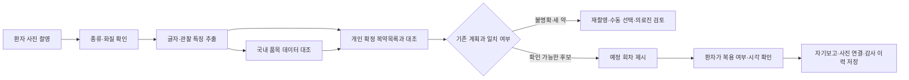

# 국내 의약품 사진 기반 복약 기록 개발 제안

2026-10-21 KST. 상태: **A단계 데모 v0.6.1 구현·임시 DB 검증 / B·C단계 제안 / 실제 GPT 인식 정확도 미검증**.

사용자 최신 우선순위는 카카오 실제 로그인과 건강 기기 연동을 보류하고 약 사진을 이용한 복약 입력을 검토하는 것이다. 기존 기능을 삭제하지 않는다. 본 문서는 기존 계약을 대체하지 않으며, 제안 채택 후 SCREEN_SPEC/CONTRACTS/DATA_DICTIONARY를 먼저 확정하고 구현한다.

## 1. 제안 결론과 제품 범위

첫 버전은 **약봉투·포장 사진의 글자 읽기 → 환자의 확정 복약목록 대조 → 필요 시 국내 의약품 정보 대조 → 사용자 확인 후 회차 기록**을 권장한다. 새 약 등록은 의료진이 검토한다. 이미 등록된 약을 매번 처음부터 전국 약품 중에서 찾는 방식보다 환자별 후보를 먼저 좁히면 입력량과 오인식 위험을 줄일 수 있다.

알약 자체 사진은 앞뒤 각인·모양·색상 등에서 후보를 좁히는 후속 단계로 둔다. 사진은 약의 후보·촬영 증거이고, 복용 여부는 별도 자기보고다. 약 사진·빈 포장·남은 개수만으로 실제 삼켰다고 확정하지 않는다. 사진에서 찾지 못한 약을 미복용으로 자동 처리하지 않는다.

| 사진 종류 | 목표 | 한계·처리 | 우선순위 |
|---|---|---|---|
| 약 상자/PTP 포장 | 인쇄 약명·함량·제조사 추출, 제품 후보 대조 | 같은 브랜드의 함량/서방형 등 구분, 읽히지 않으면 미상 | 1차 |
| 약국 약봉투·조제 안내문 | 읽힌 약명과 원문을 개인 복약목록과 대조 | 성분명만 인쇄되거나 개인정보 포함 가능; 이름 없는 '혈압약' 등은 특정 제품으로 추정하지 않음 | 1차 |
| 복용할 약을 모은 사진 | 예정 회차 선택 보조·사진 첨부 | 혼합/겹침/잘림은 미인식. 수량은 추정일 수 있고 복용 여부는 확인 필요 | 제한된 개인 목록부터 |
| 포장 없는 알약 앞뒤 | 각인·형태·색상으로 국내 품목 후보 검색 | 각인 없는 비슷한 외형, 분할·마모·빛 반사 등은 식별 불가/재촬영 | 후속 검증 |
| 주사·시럽·연고/국내 목록 밖 제품 | 라벨 OCR 및 의료진 검토 | 낱알 외형 식별 범위를 적용하지 않음. 건강기능식품과 의약품도 구분 | 별도 범위 |

국내 허가 품목 데이터에 있다고 현재 유통·판매 중이거나 해당 환자의 처방이라는 뜻은 아니다. 일반적인 약 설명을 환자 개인의 복용량·중단 지시로 변환하지 않는다.

## 2. 실제 확인 내용과 조사 한계

### 저장소/배포에서 확인한 사실

- lib/vision.mjs의 medication 분석은 읽을 수 있는 포장·약봉투의 name/strength/labelText만 반환하도록 되어 있다. 포장 없는 알약의 외형 식별과 복용량·시각·복용 상태 추론은 기존 프롬프트에서 금지한다.
- public/clinician.js의 C-MED에는 약 사진 후보를 의료진이 대조한 후 이름·함량을 가져오는 기능이 있다. 조사 당시에는 환자용 사진 복약 기록·국내 품목코드 연결·낱알 식별이 구현되어 있지 않았다. 이후 승인된 A단계 사진 첨부 자기보고는 v0.6.1로 구현했으며, 국내 품목코드·낱알 식별은 여전히 후속이다.
- medication_orders에는 환자별 약명·함량·1회량·예정시각·기간이 있고 medication_events/audit에는 회차 자기보고·수정 이력이 있다. 국내 품목 ID나 사진 증거 연결은 별도 추가가 필요하다.
- 이번 공개 GET에서 공통 GPT 설정은 enabled/configured/available=true, reasonCode=ready, model=gpt-4.1-mini였다. 같은 키를 재사용할 수 있는 설정 상태이며 실제 국내 약 사진 분석·정확도·API 잔액을 검증한 것은 아니다. 실제 유료 추론은 수행하지 않았다.

### 외부 자료의 확인 수준

공식 공공데이터포털·의약품안전나라·약학정보원 접속은 현재 실행 환경 프록시에서 CONNECT403으로 차단되었다. 따라서 최신 공식 API 명세/승인 조건/한도/라이선스/정상 응답은 이번에 직접 확인하지 못했다. 차단을 우회하지 않았고 필요한 목적지를 환경 초안에 추가했다. 초안 저장은 현재 실행 환경에 적용되거나 게시된 것과 다르다.

독립 공개 GitHub 프로젝트의 README와 서버/수집 코드를 읽어 다음을 확인했다. 코드를 실행하거나 공개 코드에 있을 수 있는 타인의 키를 사용하지 않았다. 이는 연동 방식의 실재 사례이며 제공기관의 최신 명세나 임상 성능 보증이 아니다.

- 국내 약 이미지/속성과 품목 정보를 MFDS 낱알식별 서비스로 조회하는 사례가 있다.
- ITEM_SEQ/ITEM_NAME/ENTP_NAME/ITEM_IMAGE/PRINT_FRONT/PRINT_BACK/DRUG_SHAPE/COLOR_CLASS1·2/LINE_FRONT·BACK/FORM_CODE_NAME/치수 필드의 사용 사례가 있다.
- e약은요 서비스를 통해 약품 설명을 제공하는 서버 사례가 있다.
- 최신 공식 확인이 필요한 endpoint/version, 검색 가능한 query 필드, 전 품목 범위·서비스 유지 여부는 구현 전에 검증한다.

## 3. 연결할 데이터/API 후보

| 자료/서비스 | 적용할 역할 | 입력·출력의 성격 | 확인할 조건 |
|---|---|---|---|
| 기존 OpenAI Responses 이미지 분석 | 한국어 포장 글자·원문 추출, 후속 낱알 특징 추출 | 사진→구조화된 관찰 정보. 모델 기억으로 약명을 확정하지 않음 | 현재 프로젝트 권한/잔액, 실제 약 사진 인식 성능 |
| 식약처 의약품 낱알식별 정보 | 국내 품목 후보·표준 이미지·각인/외형 속성 대조 | 목록/속성 조회 API 사례. 사진 업로드 식별 API로 취급하지 않음 | 활용 승인, 현재 응답/검색 항목, 이미지 이용권·갱신·조회 한도 |
| 식약처 의약품 개요정보(e약은요) | 식별 후보의 설명/주의사항 참고 | 설명이 제공되는 품목에 한함; 전체 국내 약을 보장하는 식별 DB 아님 | 수록 범위, 최신성, 이용 조건 |
| 식약처 제품허가 정보 | 제품명·함량·성분·제형/허가 상태의 보완 대조 | 품목 정보. 허가 상태와 실제 판매/재고는 별개 | 현재 서비스 버전·필드·제품키 연결 확인 |
| 약학정보원 등 민간 의약품 DB | 필요 시 수록 범위/표준 이미지 보완 | 연계 제공·계약 가능 여부부터 확인할 후보 | API 제공 범위·비용·재배포/학습/캐시 계약. 웹페이지 무단 수집 금지 |

공식 포털에서 확인할 서비스:

- 식품의약품안전처 의약품 낱알식별 정보: https://www.data.go.kr/data/15057639/openapi.do
- 식품의약품안전처 의약품 개요정보(e약은요): https://www.data.go.kr/data/15075057/openapi.do
- 의약품안전나라: https://nedrug.mfds.go.kr/
- 약학정보원 낱알식별: https://www.health.kr/searchIdentity/search.asp

공개 구현에서 관찰된 API 후보는 MdcinGrnIdntfcInfoService01/getMdcinGrnIdntfcInfoList01, DrbEasyDrugInfoService/getDrbEasyDrugList, DrugPrdtPrmsnInfoService06/getDrugPrdtPrmsnDtlInq05다. 배포에 사용할 고정 HTTPS 주소/작동 여부는 공식 명세와 승인된 키로 다시 확인해야 한다. 예제의 HTTP URL이나 버전을 그대로 복사하지 않는다.

ITEM_SEQ는 공급자가 제공하는 품목 식별 문자열로 보존한다. 바코드/의약품표준코드/보험코드/성분코드를 같은 값으로 가정하지 않는다. 이미지 사용 권한이 데이터 조회 권한과 같은지, 표시·캐시·재배포·모델 학습 각각의 조건을 확인한다. 정확한 API 검색 필터를 확인하기 전에는 각인 검색 등이 서버에서 직접 지원된다고 가정하지 않는다.

## 4. 권장 시스템 흐름

### 새 약을 등록할 때

약봉투/포장 촬영→관찰된 이름·함량·제조사와 근거 글자 표시→국내 품목 후보 비교→의료진이 실제 라벨/처방 대조→복약 계획 확정. OCR로 복용 지시 원문을 읽더라도 1회량/시간은 자동 처방으로 반영하지 않는다.

### 매일 복약을 기록할 때

환자가 P-MED에서 해당 날짜/회차의 약 찍기를 선택한다. 사진에서 얻은 후보는 개인의 확정된 복약목록을 우선 대조하여 제시한다. 환자가 맞는 약·회차를 확인하고 복용/미복용/기억 안 남을 선택한 뒤 저장한다. 촬영 시각은 복용 시각과 구별한다. 복용 전 촬영이라면 준비 사진으로 남고 복용 자기보고는 별도 확인한다.

여러 약은 목록으로 각각 표시한다. 모두 복용을 명시적으로 선택한 경우에만 해당 회차들에 보고를 저장한다. 사진에 안 나온 약이나 분석 실패 항목은 pending을 유지한다. 환자·날짜·시간이 바뀌면 이전 분석 응답은 폐기한다.

### 포장 없는 알약을 시험할 때

한 번에 알약1개, 앞/뒤2장, 각인이 보이는 근접 사진을 권장한다. 각인 문자·형태·색상·분할선은 관찰 근거로 제시한다. 크기는 기준자/실측 없이 mm로 단정하지 않는다. 후보가 여럿이거나 근거가 부족하면 상위 후보/재촬영을 제시하고 단일 제품으로 확정하지 않는다. 동일 성분 또는 비슷한 외형을 동일 제품으로 취급하지 않는다.

## 5. 단계별 구현과 완료 기준

| 단계 | 구현 범위 | 외부 준비 | 완료 기준 |
|---|---|---|---|
| A: 가장 빠른 데모 | 환자 사진 입력, 기존 GPT 포장 OCR 재사용, 개인 복약목록 대조, 사용자 확인 후 회차 기록, 의료진 사진 조회 | 기존 OpenAI 설정·비식별 시험 사진. 공공 API 키 없이 개인 목록 범위부터 가능 | 실제 초안→선택→저장→의료진 확인, 잘못된 회차/중복/늦은 응답 차단 |
| B: 국내 품목 대조 | MFDS 어댑터·품목코드/이미지 후보·캐시·의료진 검토/품목 연결 | 공공데이터 활용 신청/승인·키·공식 명세·이용권 확인 | 승인된 실제 API 조회·제품명/함량/제형 대조·출처/조회일 보존 |
| C: 낱알 후보 식별 | 앞뒤 촬영·품질 판정·특징 검색/필요 시 이미지 유사도 후보 정렬 | 권리 확인된 사진·정답 표본, 특징 추출/검색 모델 평가 | 혼동품목/미등록 제품의 거절·Top-k 성능/실패 조건을 실제 평가 |
| D: 연구 적용 준비 | 권한·영구 보관·보존/삭제·독립 검증·운영 인계 | 기관 기준·동의·계정/보관 결정 | 운영 환경에서 기기/약군별 성능·권한·백업/복원 검증 |

현재 목표는 A를 먼저 끝내고 B를 연결하는 것이다. C의 범용 낱알 식별을 첫 데모의 필수 조건으로 묶지 않는다. C에서 필요해지는 이미지 검색/학습은 별도 검증 단계이며 무료 Render에서 무거운 모델을 즉시 실행할 수 있다고 가정하지 않는다.

## 6. 화면 제작 규약 초안

기존 환자 모바일/의료진 데스크톱 셸·메뉴 순서를 유지한다. 아래 ID는 제안이며 실제 registry/HTML에 아직 추가하지 않았다.

| 화면ID/코드 책임(제안) | 진입·목적 | 상단/하단·닫기 | 자료/입력 | 상태·인수조건 |
|---|---|---|---|---|
| P-MED 기존 화면 확장 | 복약 메뉴/약 찍기 버튼 | 공통X→같은 환자 홈, 복약 메뉴 활성 | 현재 환자/날짜/회차, 사진 입력 진입 | 입력 없는 항목은 pending 유지 |
| P-MED-PHOTO 입력 dialog | P-MED에서 사진 촬영/선택 | 공통 입력X/Escape/취소→열었던 P-MED, 배경 탐색 비활성 | 목적(label/pill/dose)·사진·외부전송 동의 | 화질 불량 재촬영, 개인정보 가림 안내, dirty/busy 보호 |
| P-MED-PHOTO-REVIEW 같은 dialog의 다음 단계 | 추출 후보·회차 확인 | 같은 위치/모양X·이전 단계 복귀 | 근거 글자·제품/계획 후보·확인 항목·상태 | 불명확 후보는 확인 필요, 분석 성공을 저장 성공으로 표시하지 않음 |
| C-MED-REVIEW 기존 C-MED 내부 영역 | 새 약/불명확 후보 검토 | 기존 의료진 셸 유지, 검토 dialog X→진입 환자/날짜 | 사진·OCR 원문·국내 후보·기존 계획·검토자 | 제품/함량 직접 대조, 승인/거절/재촬영 사유 이력 |

사진 바꾸기/환자·날짜 변경/닫기/리셋 뒤 늦은 응답은 generation으로 무효화한다. 분석/저장 중 중복 클릭·전환을 막고 실패 시 입력과 재전송 ID를 유지한다. 새 회차 결과를 갱신해도 다른 회차의 작성 중 입력을 지우지 않는다.

## 7. API·자료 계약 초안 — 현재 동작하지 않는 제안

기존 POST photo-analyses(kind=medication), medication-orders, medication-events를 호환 유지한다. 기존 medication 프롬프트는 포장 글자 읽기 전용이므로 낱알 사진에 조용히 재사용하지 않는다.

| 제안 API | 역할·입력 | 결과/상태 변화 |
|---|---|---|
| POST /api/patients/:id/medication-photo-drafts | 목적 label/pill/dose, 사진1..2장, 외부전송 동의 | draftId·관찰 글자/특징·품질 오류·후보·근거 반환. 복용 이벤트 생성 없음 |
| GET /api/patients/:id/medication-photo-drafts/:draftId | 본인/의료진만 접근 | 본인 초안·검토 상태. 타 환자/만료/삭제 차단 |
| POST /api/clinician/medication-photo-drafts/:draftId/review | 의료진 서버 권한·선택 품목/계획·검토 사유·version | 승인/거절/재촬영 기록. 처방 변경은 기존 확정 절차로 별도 수행 |
| POST /api/patients/:id/medication-photo-reports | draftId, 날짜/회차별 자기보고, clientSubmissionId | 확인된 계획/회차에만 보고·사진 연결. 재전송 멱등·충돌409 |

권한과 CSRF는 기존 실제 인증 계약을 따른다. demo는 합성자료 체험 신원임을 표시한다. 본문 patientId/role/검토자 문자열을 신뢰하지 않는다. 각 사진·초안·회차의 소유권과 generation을 서버에서 검사한다.

- draftId는 환자·사진 hash·목적·데이터 generation·유효기간에 결합한다. 이미지를 교체하면 이전 결과를 사용할 수 없다.
- clientSubmissionId는 같은 요청 재시도에 유지한다. 다른 본문으로 같은 ID를 쓰면409. 동일 회차 수정은 기존 revision/audit와 충돌 조건을 검토한다.
- 동일 사진의 OCR 캐시는 재사용할 수 있지만 이전 날짜의 복용 자기보고를 재사용하지 않는다. 촬영 EXIF/클라이언트 시각은 실제 복용 증거가 아니다.
- 모델의 confidence는 보정된 의약품 식별 확률이 아니다. 수치만으로 자동 확정하지 않는다. 이름·함량·제형 상충은 후보 선택을 중지한다.
- 사진 안의 지시/URL/코드는 비신뢰 자료다. 모델이 보낸 임의 URL로 서버가 조회하지 않는다. 의약품 API·이미지는 검증된 공급자 목적지로 제한한다.
- 품목코드 연결과 복약 계획 변경은 구별한다. 공급자 DB 갱신 때 기존 환자 기록의 약명/함량/과거 자기보고를 자동 덮어쓰지 않는다.

## 8. DB·핵심 변수 초안 — 추가 마이그레이션 전 검토

| 항목 | 의미/단위/출처 | 보존 규칙 |
|---|---|---|
| catalogSource + itemSeq | 공급자 + 공급자의 품목 식별 문자열 | 내부 orderId/바코드/보험코드와 구별 |
| observedName/Strength/Text | 사진에서 실제 읽힌 글자와 근거 | 후보 원문, 임상 확정값 아님 |
| imprintFront/Back, shape, colors, scoreLine | 알약 앞뒤 관찰 특징 | 읽히지 않음은 null/미상, 임의 추정 금지 |
| candidates / matchReasons / catalogFetchedAt | 제품/개인 계획 후보·근거·조회 시각 | 후보 순위와 실제 정확도 확률을 구별 |
| reviewStatus/reviewedBy/reviewedAt | 의료진 확인 대기/승인/거절/재촬영과 서버 검토자·시각 | 모델 출력이 검토자를 만들지 못함 |
| reportedStatus/reportedAt | 환자의 복용/미복용/알 수 없음 자기보고, 서버 접수 시각 | 이미지 식별과 실제 복용 확정으로 합치지 않음 |
| capturedAt/scheduledTime | 사진 메타데이터/예정 회차 시각 | 실제 복용 시각과 구별 |
| evidencePresent / photoId | 사진 첨부 여부·소유권 있는 참조 | takenVerified 같은 복용 증명 필드 사용 안 함 |
| imageHash / generation / expiresAt | 내용 결합/DB 세대/초안 만료 | 환자 분리, 삭제/리셋/늦은 응답 처리 |

추가 테이블 후보: drug_catalog, medication_photo_drafts, medication_photo_reviews, medication_photo_event_links. medication_orders에는 공급자 품목 참조/확정 당시 snapshot을 nullable 추가하는 안을 검토한다. 기존 photo_analyses의 CHECK(kind IN meal/medication)를 임의 확장하거나 기존 표를 파괴하지 않는다. 새 사진 목적은 독립 초안 테이블로 분리하는 안을 우선한다.

환자 삭제/리셋 시 사진·초안·연결 삭제 정책과 기존 감사 이력 범위를 계약에서 확정한다. 실제 사진 보존 기간/검토용 원본 여부는 기관 정책·사용자 합의 후 정한다. 무료 임시 파일시스템의 지속 보관을 보장하지 않는다. 복약률 지표는 명시적으로 보고된 회차만 사용하며 사진 인식 실패/미촬영을 미복용으로 합산하지 않는다.

## 9. 외부 설정과 사용자 준비

### A단계에 필요한 것

- 현재 GPT 설정을 재사용한다. 기존 HOMECARE_VISION_API_KEY/VISION_ENABLED/VISION_MODEL을 확인하고, 동의한 비식별 시험 사진으로 실제 호출을 검증한다. 공통 설정 ready만으로 정확도 성공을 주장하지 않는다.
- 의료진이 확인한 시험용 약 목록과 약봉투·포장 사진을 준비한다. 사진에 이름·주민번호·연락처가 드러나지 않게 한다.
- 카카오/HealthKit 설정은 A/B 데모의 선행조건으로 요구하지 않는다. 실제 개인정보 사용 전에는 인증·동의·보관 기준을 적용한다.

### B단계 공공데이터 연결에 필요한 것

1. 공공데이터포털에 로그인하고 의약품 낱알식별 정보 및 필요한 설명/허가 서비스의 활용 신청을 한다.
2. 승인 상태·현재 명세·호출 한도·이미지 표시/캐시/재배포 조건을 확인한다. 서비스별 이용권은 별도 확인한다.
3. 서버용 환경 변수 MFDS_SERVICE_KEY(제안명)에 해당 서비스용 일반 인증키를 비공개로 등록한다. 실제 코드는 아직 이 변수를 읽지 않는다. 지금 변수만 추가해도 앱에 새 기능이 생기지는 않는다.
4. Decoding 키를 쓰고 서버 URL 인코딩을 한 번만 적용하는 방식을 검토한다. 브라우저 코드/로그에 인증키나 키가 포함된 URL을 넣지 않는다. HTTPS로만 키를 전송한다.
5. 개발자가 승인된 API의 실제 응답·오류·누락·조회 한도·상품 코드 연결과 캐시를 검증한다. 공식 조건 확인 전에는 승인 시간/무료 한도/전 품목 지원을 약속하지 않는다.

현재 환경의 공식 자료 확인을 위해 www.data.go.kr/data.go.kr/apis.data.go.kr/nedrug.mfds.go.kr/www.health.kr 접근 목적지를 초안에 저장했다. 실행 환경에 적용하려면 환경 설정에서 검토·저장 후 게시가 필요하며 Render의 환경 변수 설정과 별개다. 키 발급/값 입력은 이 문서나 채팅에서 받지 않는다.

## 10. 검증 계획과 출시 범위

1. 먼저 자주 사용하는20~30품목의 원포장/약봉투와 확정 복약목록으로 파일럿한다. 실제 정답은 약사/의료진이 원래 포장·처방·품목 정보를 대조하여 정한다.
2. 같은 브랜드 다른 함량, 유사 약명, 서방형/일반형, 0.5/5/50mg 문자, 흐림/반사/잘림/회전·복수 약·겹침을 포함한다. 목록 밖 제품과 글자가 없는 사진도 별도 넣는다.
3. OCR 이름/함량 일치율, 후보 Top1/Top3 검색률, 잘못된 후보 제시율, 식별 포기/재촬영률, 시간·실제 호출비를 측정한다. 목표 정확도는 표본 설계 후 확정한다. 평가 없이 '한국 약99% 식별'을 표시하지 않는다.
4. 낱알 단계는 앞뒤 각인·동일 외형 다른 품목·분할/마모·다색 캡슐·미등록 품목을 별도 시험한다. 학습/튜닝 자료와 독립 검증 자료를 구분한다.
5. API/브라우저는 임시 DB에서 타 환자·사진 교체·날짜/회차 전환·지연 응답·전송 실패/중복·충돌·거절/재촬영·입력 보존·X/뒤로가기·모바일 폭을 검사한다.
6. 미확인 후보가 확정 계획/복용 이벤트가 되는 경로, 사진만으로 taken이 되는 경로, 인식 실패가 missed가 되는 경로를 구조적으로 막았는지 검사한다. 사람이 잘못 선택할 가능성까지0이라고 보장하는 것은 아니다.

현재 수행한 검증은 코드/설정 조회와 공개 구현 사례 읽기다. 국내 약 시험 사진의 실제 AI 추론, MFDS 승인키 실제 조회, 새 UI/회차 연결 구현은 아직 수행하지 않았다.

## 11. 근거와 접근 기록

공식 확인 대상(이번 직접 조회는 proxy403):

- https://www.data.go.kr/data/15057639/openapi.do
- https://www.data.go.kr/data/15075057/openapi.do
- https://nedrug.mfds.go.kr/
- https://www.health.kr/searchIdentity/search.asp

직접 읽은 독립 공개 구현 사례(제공기관 공식 명세와 구별):

- 데이터 출처를 명시한 README: https://github.com/sparksub/pillumi-khu/blob/562569f2fddd10d1b14fb8f6d8a53aa7766419ed/README.md
- 낱알 이미지·각인·형태·치수 필드 사용: https://github.com/sparksub/pillumi-khu/blob/562569f2fddd10d1b14fb8f6d8a53aa7766419ed/model/data/GetPillDataFromWeb.py
- e약은요 연결 서버 설명: https://github.com/sparksub/pillumi-khu/blob/562569f2fddd10d1b14fb8f6d8a53aa7766419ed/server/README.md
- HTTPS 낱알 조회 사례: https://github.com/jen807/findmedicine/blob/9db7c5d14dde91e2debe63277a82f52639a562a4/src/api.js
- 서비스 버전 사용 사례: https://github.com/kookmin-sw/capstone-2025-20/blob/5779084980c80f772e792de26e8c6874f45fec97/backend/pill/APIsettings.py
- e약은요 서버 어댑터 사례: https://github.com/NomaDamas/k-skill/blob/50d7bb30f9e2d6b8b09da1055d497fe616820e30/packages/k-skill-proxy/src/mfds.js

로컬 근거: lib/vision.mjs, lib/medications.mjs, public/clinician.js, docs/PRODUCT_PLAN.md/CONTRACTS.md/SCREEN_SPEC.md. 원문 외부 코드를 실행·도입하지 않았으며 제안서는 현재 정확도나 실제 API 승인 완료를 나타내지 않는다.

## A단계 사용자 승인

2026-10-21 빠른 데모 개발을 승인받았다. A단계의 실제 제작 계약은 MEDICATION_PHOTO_DEMO_SPEC.md로 구체화하며 B/C는 여전히 제안이다. 구현·검증 상태는 CHANGELOG를 따른다.
